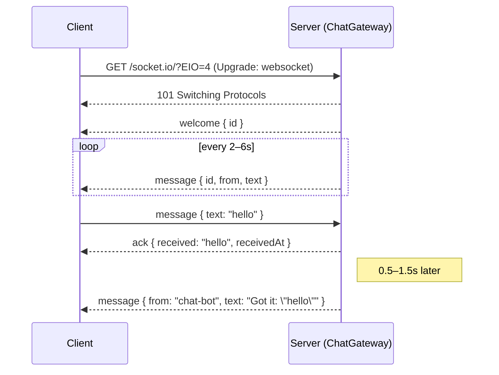
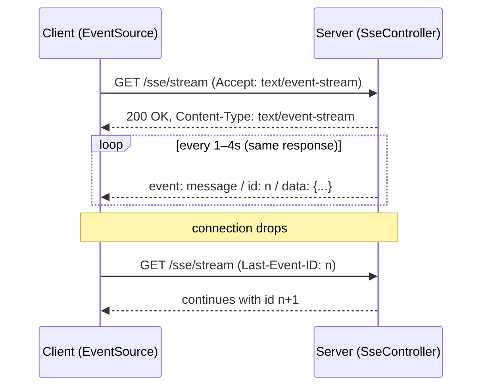
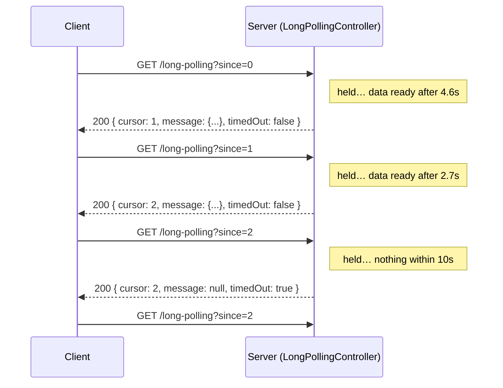

# NestJS Realtime Patterns

A NestJS app that shows the three most common ways for a server to push data to a client in real time. Each pattern is a **separate, standalone demo**, and the server **simulates incoming data** (random notifications, bot replies) so there is always something to watch.

| # | Pattern | Endpoint | Direction | What the demo does |
|---|---------|----------|-----------|--------------------|
| 1 | **WebSockets** (Socket.IO) | `ws://localhost:3000/chat` | Client ⇄ Server | After you connect, the server sends random messages. Whatever you send is acknowledged and answered by a bot |
| 2 | **Server-Sent Events** | `GET /sse/stream` | Server → Client | You make one request. Random messages keep arriving on that open response |
| 3 | **Long Polling** | `GET /long-polling?since=<id>` | Server → Client | Each request is held until a simulated message is ready (or a timeout), then the client polls again |

The patterns don't share any state. Every connection or request gets its own simulation.

---

## Table of contents

- [Quick start](#quick-start)
- [Project structure](#project-structure)
- [1. WebSockets (Socket.IO)](#1-websockets-socketio)
- [2. Server-Sent Events (SSE)](#2-server-sent-events-sse)
- [3. Long Polling](#3-long-polling)
- [Comparison and choosing a pattern](#comparison-and-choosing-a-pattern)
- [Going to production](#going-to-production)

---

## Quick start

Requirements: **Node.js 20+** (tested on Node 22).

```bash
npm install
npm run start:dev        # watch mode
# or
npm run build && npm run start:prod
```

Open **http://localhost:3000**. The demo page has one independent panel per pattern:

- **WebSocket:** click **Connect**. Messages start arriving every few seconds. Type something and press **Send** to get an ack and a bot reply.
- **SSE:** click **Open stream**. The panel shows the request (`→ GET /sse/stream`), the response (`← 200 text/event-stream`) and then each event as it arrives.
- **Long Polling:** click **Start polling**. The panel shows every request, how long the server held it, and what it returned.

Set `PORT` to use a different port: `PORT=4000 npm run start:dev`.

All simulated messages share one shape:

```json
{ "id": 3, "from": "price-bot", "text": "BTC just moved 2.3% in the last hour", "createdAt": "2026-10-25T16:33:51.035Z" }
```

---

## Project structure

```
src/
├── main.ts                              # bootstrap, CORS, serves public/
├── app.module.ts
├── simulation/
│   └── simulated-message.ts             # random message / reply generators (stateless)
├── websocket/
│   └── chat.gateway.ts                  # Pattern 1: Socket.IO gateway
├── sse/
│   └── sse.controller.ts                # Pattern 2: Server-Sent Events
└── long-polling/
    └── long-polling.controller.ts       # Pattern 3: Long polling
public/
└── index.html                           # browser demo client for all three
scripts/
└── ws-client.mjs                        # terminal Socket.IO client
```

---

## 1. WebSockets (Socket.IO)

**Code:** [src/websocket/chat.gateway.ts](src/websocket/chat.gateway.ts)

### How it works

The client opens **one persistent connection** (an HTTP request upgraded with `101 Switching Protocols`). After that, **both sides can send at any time** over the same connection, with no new HTTP request per message.



This project uses **Socket.IO**, which adds automatic reconnection, acknowledgements, rooms/namespaces and a fallback to HTTP long polling on top of raw WebSockets. Note that a plain WebSocket client (`wscat`, the browser's `new WebSocket()`) **cannot** talk to a Socket.IO server, because Socket.IO has its own protocol on top. If you want raw WebSockets, use `@nestjs/platform-ws` with `WsAdapter` instead.

### Events

| Direction | Event | Payload | Notes |
|-----------|-------|---------|-------|
| server → client | `welcome` | `{ id }` | Once, right after connecting |
| server → client | `message` | `SimulatedMessage` | Random messages every 2–6 s, plus bot replies to what you send |
| client → server | `message` | `{ text }` | The handler's return value `{ received, receivedAt }` is sent back as the **ack** |
| server → client | `exception` | `{ status, message }` | Sent by Nest when the handler throws `WsException` (e.g. empty text) |

### Key implementation points

- `handleConnection` starts a **per-client** timer loop that emits random messages to **that socket only** (`client.emit`). Nothing is broadcast to other clients.
- Per-connection state (the message counter and timer) lives on `client.data`.
- `handleDisconnect` clears the timer, so simulations don't keep running after the client leaves.
- `handleMessage` **returns** an ack object. Nest sends that as the Socket.IO acknowledgement. The bot reply is pushed separately, a moment later, to show the server can send whenever it wants.

### How to test

**Option A: browser.** Open http://localhost:3000 and click **Connect** in the WebSocket panel. The status shows `polling` and then `websocket` once Socket.IO upgrades the transport. In DevTools → Network → **WS**, select the `socket.io` request and open the **Messages** tab to see every frame in both directions.

**Option B: the included CLI client**

```bash
npm run client:ws
```

Random messages print as they arrive. Type a line and press Enter to send it.

```
connected as -4vsC6e719k7kR9yAAAB. Type a message and press Enter.
hello server
ack: server received "hello server"
#1 chat-bot: You said "hello server" (12 chars)
#2 order-service: Heads up: rain expected around 6 PM
#3 news-bot: Build #312 passed all checks
```

**Option C: Postman.** New → **Socket.IO** request → URL `http://localhost:3000/chat`. Add listeners for `welcome` and `message`, then emit `message` with `{"text":"hi"}` and enable *Ack*.

**Option D: a few lines of Node**

```js
import { io } from 'socket.io-client';
const socket = io('http://localhost:3000/chat');
socket.on('message', console.log);
const ack = await socket.emitWithAck('message', { text: 'hello' });
```

---

## 2. Server-Sent Events (SSE)

**Code:** [src/sse/sse.controller.ts](src/sse/sse.controller.ts)

### How it works

The client makes **one normal HTTP GET**. The server answers with `Content-Type: text/event-stream` and **never finishes the response**. It keeps writing events to it as they happen. Communication is **one-way (server → client)**. The browser's built-in `EventSource` API handles parsing and **automatic reconnection** for you.



Wire format (this is literally what goes over the connection):

```
event: message
id: 1
data: {"id":1,"from":"news-bot","text":"You have 3 unread notifications","createdAt":"..."}

```

### Key implementation points

- `@Sse('stream')` turns a method that returns an `Observable<MessageEvent>` into an SSE endpoint. Nest sets the headers, serialises each emission and **unsubscribes automatically when the client disconnects**.
- The stream is `defer(() => timer(random)).pipe(repeat())`, which emits forever with a new random delay each time. Each request gets its own independent stream.
- Each event carries an `id`. When `EventSource` reconnects it sends the last one back in the **`Last-Event-ID`** header, and the controller continues numbering from there. In a real app you would use that id to **replay the events the client missed**.
- `finalize()` logs `Stream closed by client` so you can see the cleanup in the server console.

### How to test

**Option A: browser.** Open http://localhost:3000 and click **Open stream**. The panel logs:

```
→ GET /sse/stream   Accept: text/event-stream
← 200 OK   Content-Type: text/event-stream (response stays open)
news-bot: You have 3 unread notifications   #1
chat-bot: Your report is ready to download   #2
...
```

In DevTools → Network, click the `stream` request. It stays *pending* (it is one response that never ends), and the **EventStream** tab lists each event with its id and type.

To see reconnection: stop the server while the stream is open. The panel shows *reconnecting…* and the `Last-Event-ID` it will send. Start the server again: `EventSource` reconnects by itself and the ids continue from where they stopped.

**Option B: curl.** `-N` turns off buffering so events show up as they arrive. Add `-v` to also see the request and response headers.

```bash
curl -N -v localhost:3000/sse/stream
```

```
> GET /sse/stream HTTP/1.1
> Accept: */*
< HTTP/1.1 200 OK
< Content-Type: text/event-stream
< Connection: keep-alive
< Cache-Control: private, no-cache, no-store, must-revalidate, max-age=0, no-transform

event: message
id: 1
data: {"id":1,"from":"news-bot","text":"You have 3 unread notifications",...}

event: message
id: 2
data: {"id":2,"from":"chat-bot","text":"Your report is ready to download",...}
```

Simulate a reconnect, pretending the last event you saw was #41:

```bash
curl -N -H 'Last-Event-ID: 41' localhost:3000/sse/stream
# first event has id: 42
```

**Option C: JavaScript**

```js
const source = new EventSource('http://localhost:3000/sse/stream');
source.addEventListener('message', (e) => console.log(JSON.parse(e.data)));
```

### Limitations to know

- **Text only, one direction.** To send something to the server, use a separate HTTP request.
- **HTTP/1.1 limit of ~6 connections per browser per domain.** Every SSE tab uses one of them. HTTP/2 removes this limit.
- `EventSource` cannot set custom headers (e.g. `Authorization`). Use cookies or a query-string token, or a fetch-based SSE client.

---

## 3. Long Polling

**Code:** [src/long-polling/long-polling.controller.ts](src/long-polling/long-polling.controller.ts)

### How it works

This is ordinary HTTP request/response with a twist: **the server delays its answer until it has something to say.**

1. The client sends `GET /long-polling?since=<last id it has seen>`.
2. The server **holds the request open** until a message is available, or a timeout passes.
3. It responds with the message (or `message: null` on timeout).
4. The client processes the response and **immediately sends the next request** with the new cursor.

In this demo the "next message" becomes available after a **random 1–15 s**, and the timeout is **10 s**. So some polls return a message and some time out, and you see both cases.



### API

`GET /long-polling`

| Query param | Default | Meaning |
|-------------|---------|---------|
| `since` | `0` | The last message id the client has. The next message will have `id = since + 1` |
| `timeout` | `10000` | Max milliseconds to hold the request (capped at `30000`) |

Response:

```json
{ "cursor": 1, "message": { "id": 1, "from": "news-bot", "text": "...", "createdAt": "..." }, "timedOut": false, "waitedMs": 4666 }
```

Always send the returned `cursor` back as `since` on the next request.

### Key implementation points

- The handler returns a `Promise` that resolves on **whichever comes first**: the simulated data timer, the timeout timer, or the client disconnecting (`res.on('close')`).
- `finish()` clears both timers and removes the listener on every exit path. Without it, every abandoned poll would leak timers.
- The timeout should stay below proxy/load-balancer idle limits (often 30–60 s), or the infrastructure kills requests with a `504` before the app responds.
- `@Res({ passthrough: true })` gives access to the Express response for the `close` event, while Nest still serialises the return value.

### How to test

**Option A: browser.** Open http://localhost:3000 and click **Start polling**. The panel logs each request and response:

```
→ GET /long-polling?since=0
← 200 after 4.7s   1 message
news-bot: Heads up: rain expected around 6 PM   #1
→ GET /long-polling?since=1
← 200 after 10.0s   no new data (timed out)
→ GET /long-polling?since=1
...
```

In DevTools → Network you will see one `long-polling` request *pending* at a time. Each completes, and the next one starts right away.

**Option B: curl.** Each call hangs until the server has something.

```bash
curl -w '  (%{time_total}s)\n' 'localhost:3000/long-polling?since=0'
# {"cursor":1,"message":{...},"timedOut":false,"waitedMs":4666}  (4.67s)

# Shorter timeout, so you'll often see timedOut: true
curl -w '  (%{time_total}s)\n' 'localhost:3000/long-polling?since=1&timeout=3000'
# {"cursor":1,"message":null,"timedOut":true,"waitedMs":3001}  (3.00s)
```

**Option C: a polling loop in bash** (this is what a real client does)

```bash
cursor=0
while true; do
  res=$(curl -s "localhost:3000/long-polling?since=$cursor")
  echo "$res"
  cursor=$(echo "$res" | node -pe 'JSON.parse(require("fs").readFileSync(0)).cursor')
done
```

**Option D: JavaScript**

```js
let cursor = 0;
while (true) {
  const body = await fetch(`/long-polling?since=${cursor}`).then((r) => r.json());
  cursor = body.cursor;
  if (body.message) console.log(body.message);
}
```

---

## Comparison and choosing a pattern

| | WebSockets | Server-Sent Events | Long Polling |
|---|---|---|---|
| **Direction** | Bidirectional | Server → client | Server → client (client sends with separate requests) |
| **Connection** | 1 persistent TCP connection | 1 long-lived HTTP response | A new HTTP request after every response |
| **Latency** | Lowest | Low | Low, plus one round trip per message |
| **Overhead per message** | A few bytes of framing | A few bytes of text | Full HTTP headers on every cycle |
| **Data format** | Text and binary | UTF-8 text only | Anything HTTP can carry |
| **Auto reconnect** | Socket.IO: yes. Raw WS: do it yourself | Built into `EventSource` | Built in by design (the loop) |
| **Resume after disconnect** | Do it yourself (send a cursor on reconnect) | Built in via `Last-Event-ID` | Built in via `?since=` cursor |
| **Proxies / firewalls** | Need `Upgrade` support. Some corporate proxies block it | Plain HTTP, works almost everywhere | Plain HTTP, works everywhere |
| **Horizontal scaling** | Sticky sessions + pub/sub adapter | Pub/sub; no stickiness needed | Pub/sub; fully stateless with a cursor |
| **Best for** | Chat, multiplayer games, collaborative editing | Notifications, live feeds, dashboards, progress, LLM token streaming | Restrictive networks, simple infrastructure, low message rates |

**Rule of thumb**

- The client needs to send frequent, low-latency messages too → **WebSockets**.
- Only the server pushes (feeds, notifications, progress, AI streaming) → **SSE**. It is simpler, it is plain HTTP, and reconnect and resume come for free.
- You can't rely on long-lived connections (old proxies, strict corporate networks, serverless platforms with short timeouts) → **Long polling**.

> Socket.IO itself starts with HTTP long polling and upgrades to WebSocket when it can. You can see the switch in the WebSocket panel's status (`polling` → `websocket`).

---

## Going to production

The simulations here stand in for real event sources. In a real app:

- **Real data source.** Replace the timers with your actual events: a database change, a queue consumer, or a Redis/NATS/Kafka subscription. With several app instances, every instance needs to receive the events, so use a pub/sub system rather than in-process state. For Socket.IO, add the **Redis adapter** (`@socket.io/redis-adapter`) and **sticky sessions**.
- **Replay.** Store events with increasing ids (DB table, Redis Streams) so SSE's `Last-Event-ID` and long polling's `since` can return what a client missed.
- **Authentication.**
  - WebSocket: validate a token in the handshake (`client.handshake.auth.token`) and disconnect unauthorised clients.
  - SSE: `EventSource` can't send headers, so use a cookie or a short-lived query token.
  - Long polling: normal HTTP guards work.
- **Proxies.**
  - Set idle timeouts above your SSE event gap and long-poll timeout.
  - For Nginx and SSE, disable buffering (`proxy_buffering off;` or the `X-Accel-Buffering: no` header).
  - For Nginx and WebSockets, forward `Upgrade`/`Connection` headers.
  - Prefer HTTP/2 for SSE.
- **CORS.** This demo allows `*`. Restrict it.
- **Validation.** Use `class-validator` DTOs with `ValidationPipe`, which also works on gateways.

---

## Tech

- NestJS 12, TypeScript 6, Express 5
- Socket.IO 4
- RxJS 7

## License

MIT
